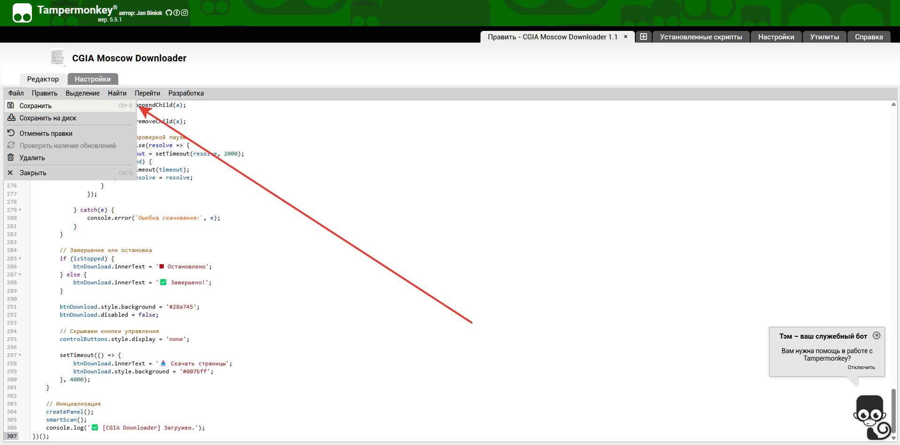
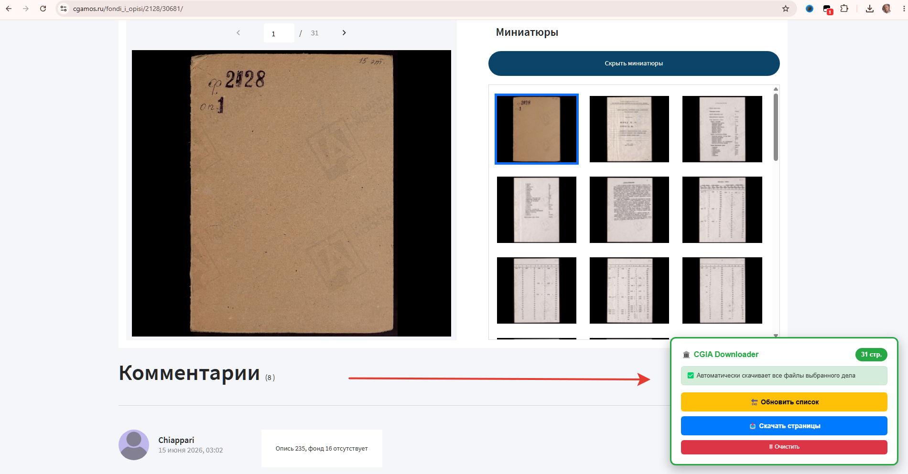

# 📥 CGIA Moscow Downloader

Пользовательский скрипт (UserScript) для автоматического скачивания всех страниц архивного дела в высоком разрешении с сайта [Центрального государственного архива города Москвы (ЦГА Москвы)](https://cgamos.ru/).

Скрипт автоматически определяет папку с документами, отсеивает мусор (иконки, миниатюры боковой панели) и скачивает файлы с их оригинальными именами (например, `0001.jpg`). Встроенные функции **Паузы** и **Стопа** дают полный контроль над процессом.

---

## 📋 Пошаговая инструкция

### Шаг 1: Установка менеджера скриптов
Если у вас еще не установлен Tampermonkey, добавьте его из официального магазина расширений:
* [Google Chrome / Яндекс.Браузер / Edge](https://chrome.google.com/webstore/detail/tampermonkey/dhdgffkkebhmkfjojejmpbldmpobfkfo)
* [Mozilla Firefox](https://addons.mozilla.org/ru/firefox/addon/tampermonkey/)
* [Safari (macOS)](https://apps.apple.com/app/tampermonkey/id1482490089)

### Шаг 2: Добавление скрипта
1. Кликните на иконку Tampermonkey в списке расширений и выберите "Создать новый скрипт".
2. Откройте в репозитории файл script.js и скопируйте все его содержимое.
3. Добавьте скопированный код в новый скрипт и нажмите Файл — Сохранить.

   **Внимание! Проверьте чтобы ы настройках Tampermonkey была нажата галочка "Разрешить пользовательские скрипты".** Проверить можно нажав правой кнопкой мыши по иконке Tampermonkey и выбрав "Управление расширениями".

### Шаг 3: Как пользоваться
1. Откройте страницу нужного дела на сайте [cgamos.ru](https://cgamos.ru/).
2. В правом нижнем углу страницы вы увидите аккуратную панель **🏛️ CGIA Downloader**.
3. Нажмите кнопку **«🔄 Обновить список»**. Скрипт мгновенно просканирует страницу, найдет папку с максимальным количеством файлов (ваше дело) и отсеет все лишнее. Счетчик покажет точное количество страниц (например, `31 стр.`).
4. Нажмите синюю кнопку **«📥 Скачать страницы»**. Подтвердите начало скачивания.
5. Во время скачивания под основной кнопкой появятся две новые кнопки:
   * **⏸ Пауза:** временно приостанавливает процесс (кнопка станет зеленой «▶ Продолжить»).
   * **⏹ Стоп:** полностью и безопасно прерывает скачивание.
6. Браузер автоматически скачает файлы в вашу папку загрузок с правильными именами (например, `0001.jpg`, `0002.jpg`).

---

## ⚠️ Возможные проблемы и решения

| Проблема | Причина и решение |
| :--- | :--- |
| **Панель скрипта не появляется** | Убедитесь, что расширение Tampermonkey включено. Проверьте, что на иконке расширения есть цифра "1", означающая, что скрипт активен для домена `cgamos.ru`. |
| **Счетчик показывает 0 страниц** | Убедитесь, что вы находитесь на странице просмотра самого дела, а не в общем каталоге описей. Нажмите кнопку «🔄 Обновить список». |
| **Скачивание идет медленно или прерывается** | Это нормальная работа скрипта. Между скачиванием файлов сделана искусственная задержка в 2 секунды. Это критически важно, чтобы сервер архива не заблокировал ваш IP-адрес за подозрительную активность (как при использовании DownThemAll). **Не закрывайте вкладку до завершения.** |

---

## 🛠 Для разработчиков

Скрипт написан на чистом JavaScript (Vanilla JS) и не требует внешних зависимостей. 
Основной механизм работы:
1. Сканирует все теги `` на странице и извлекает их атрибуты `src`, `data-src` и `data-original`.
2. Фильтрует URL, оставляя только те, что содержат `get_img.php` и заканчиваются на цифры с расширением `.jpg`/`.jpeg`.
3. **Умная группировка:** разбивает найденные ссылки по папкам и выбирает ту, в которой находится максимальное количество файлов (это и есть целевое дело), автоматически отсеивая миниатюры из боковой панели.
4. Программно удаляет сегмент `/resize/` из пути, формируя прямую ссылку на оригинал в высоком разрешении.
5. Извлекает корректное имя файла из параметра `img_path` (чтобы избежать сохранения как `get_img.php`).
6. Скачивает файлы последовательно через `fetch` с флагом `credentials: 'include'` и задержкой 2000 мс, поддерживая состояния Паузы и Стопа.

Любые Pull Request и улучшения приветствуются!

---

## 📜 Дисклеймер
Данный скрипт предоставляется "как есть" (as is) исключительно в образовательных и исследовательских целях для сохранения личных копий общедоступных архивных данных. Автор не несет ответственности за возможные изменения в структуре сайта ЦГА Москвы, которые могут привести к неработоспособности скрипта. Соблюдайте правила использования сервиса и авторские права. Не используйте автоматизаторы для массовой загрузки без задержек, чтобы не навредить работе архива.

---

### 🧬 Другие полезные инструменты от автора

Занимаетесь семейной историей и генеалогией? Обратите внимание на мой проект:

  
   
    
  <strong><a href="https://family3.site/" target="_blank">Genius Family Tree</a></strong> – Плагин семейного древа для WordPress
    
    

**Genius Family Tree** помогает исследователям и генеалогам легко создавать, структурировать и красиво отображать семейные древа, биографии и архивные данные на собственном сайте. Идеальное дополнение для тех, кто систематизирует результаты своих архивных поисков.

👉 **[Перейти на сайт проекта и узнать подробнее](https://family3.site/)**

---
*Если этот скрипт был вам полезен, поставьте ⭐ звезду этому репозиторию! Это поможет другим исследователям найти его.*
